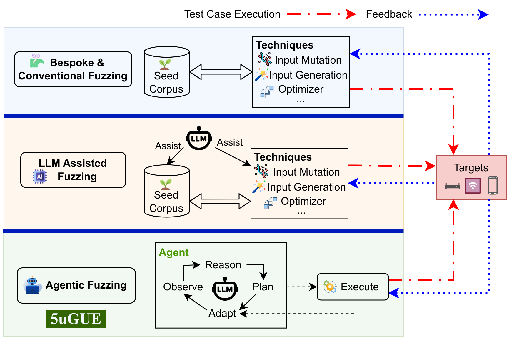
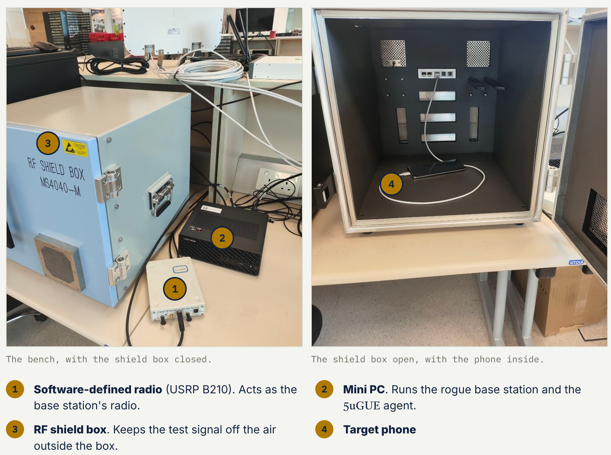

# 5uGUE: Agentic Hardware-in-the-Loop Fuzzing for 5G Devices and beyond

[](https://5ugue.pages.dev/)

🌐 **Project Website**: [https://5ugue.pages.dev/](https://5ugue.pages.dev/)

> **Code Disclosure & Testbed Scope**
>
> This repository is the open-source code artifact accompanying our paper. Its primary objective is **scientific transparency and complete open disclosure of the agentic logic, prompt designs and tool-dispatching pipelines** presented in the paper.
>
> **API Keys**: Proprietary LLM API keys are excluded; users must supply their own API keys in `secret_keys.py` (see [Configuration](#3-configuration)).
>
> **Scope of this Repository**: Because live hardware-in-the-loop fuzzing inherently depends on specialized laboratory testbeds (software-defined radios, physical COTS smartphones, programmable SIM cards, and RF cabling), this code is not intended as an out-of-the-box turnkey fuzzing tool for instant execution without an equivalent physical lab setup. All core decision logic, agent loops, search strategies, and tool interactions are completely and transparently disclosed.

> [!IMPORTANT]
> **As of today, 5uGUE has uncovered 46 unique, reproducible crashes (all leading to denial-of-service attacks) across various MediaTek and Unisoc baseband modems, 44 of which were confirmed by the vendors but had been previously reported. Additionally, MediaTek confirmed two previously unknown, high-severity vulnerabilities, one of which is assigned CVE-2026-20525**.

---

## Table of Contents

- [Overview](#overview)
- [How It Works: Closed-Loop Agentic Fuzzing](#how-it-works-closed-loop-agentic-fuzzing)
- [Technical Details & Ablation Versions](#technical-details--ablation-versions)
  - [Version Matrix (V1 – V3F)](#version-matrix-v1--v3f)
  - [Coarse-to-Fine Search Strategy (V3F)](#coarse-to-fine-search-strategy-v3f)
- [Prompt Engineering & Protocol Strategies](#prompt-engineering--protocol-strategies)
  - [Protocol Guidance & Prompt Design](#protocol-guidance--prompt-design)
  - [Mutation Taxonomy](#mutation-taxonomy)
- [Supported Devices & Target Platforms](#supported-devices--target-platforms)
- [Repository Layout](#repository-layout)
- [Requirements & Setup](#requirements--setup)
  - [1. Hardware & System Prerequisites](#1-hardware--system-prerequisites)
  - [2. Underlying Fuzzing Frameworks](#2-underlying-fuzzing-frameworks)
  - [3. Configuration](#3-configuration)
- [Usage Guide](#usage-guide)
  - [Running 5G NR Fuzzing Experiments](#running-5g-nr-fuzzing-experiments)
  - [Running Bluetooth Fuzzing Experiments](#running-bluetooth-fuzzing-experiments)
- [Acknowledgements & Citations](#acknowledgements--citations)
- [Contact](#contact)

---

## Overview



**5uGUE** is an autonomous, Large Language Model (LLM)-driven hardware-in-the-loop (HIL) fuzzing framework tailored for wireless security testing across 5G-enabled devices (such as commercial smartphones) and wireless peripherals (such as Bluetooth Classic SoCs).

Unlike conventional wireless fuzzers that rely purely on stochastic byte mutations or manual grammar modeling, 5uGUE incorporates an LLM as an active fuzzing strategist. It couples multi-step semantic reasoning with tool-assisted interactions—integrating dedicated capabilities for protocol research, deep packet inspection, memory/knowledge management, C exploit compilation, and over-the-air test dispatching. 

Operating in an autonomous closed loop, 5uGUE synthesizes targeted protocol mutations, injects them over the air to physical hardware targets via a software-defined radio (SDR) or host controller, captures runtime hardware feedback (including baseband assertion traps, system crash logs, and protocol state transitions), and dynamically steers its fuzzing strategy across successive turns.

In empirical evaluations across commercial off-the-shelf (COTS) 5G chipsets and Bluetooth devices:
- **Crash Discovery**: 5uGUE demonstrates improved crash discovery compared to baseline wireless fuzzing approaches, identifying previously unknown and unique implementation-level crashes across commercial devices.
- **Responsible Disclosure**: Crashes discovered by 5uGUE have been reported to and confirmed by baseband chipset vendors (including MediaTek and UNISOC).
- **Multi-Protocol Application**: Evaluated on both 5G NR SA cellular stacks and Bluetooth Classic.

For architecture overviews, experiment example visualizations, and summary results, visit the **[5uGUE Project Website](https://5ugue.pages.dev/)**.

---

## How It Works: Closed-Loop Agentic Fuzzing

5uGUE operates through a five-phase iterative agent loop:

1. **Reason**: The agent analyzes protocol specifications, target configuration, mutation taxonomies, and prior turn findings from its memory store to formulate a testing hypothesis.
2. **Generate**: The agent synthesizes an exploit module in C (e.g. intercepting `nr-rrc.rrcSetup_element` or `LMP_feature_req`), specifying exact packet filters, candidate byte offsets, and mutation values.
3. **Execute**: `execution_engine.py` compiles the generated C callback, links it against the underlying base station/host framework, transmits the mutated frame over the air, and supervises device health.
4. **Observe**: The execution engine collects multi-modal telemetry:
   - **Mutation Count**: Verifies if the target frame was matched and modified.
   - **Total Packets**: Detects early session drops or protocol rejection.
   - **Crash Oracles**: Traps baseband assertion panics (`sModemReason`, `MiSightJni`, `ModemAssertInfoActivity`), kernel crashes, and microcontroller resets.
   - **State-Machine Diffs**: Evaluates explored states and transitions in the protocol graph.
5. **Adapt & Reflect**: The agent updates its persistent knowledge base (`knowledge_base.py`), updates its crash map table, and refines next-turn priorities. When consecutive tests stall, an automated reflection prompt triggers strategic pivots.

---

## Technical Details & Ablation Versions

5uGUE includes configurable capability gates (`version_config.py`) to ablate and measure the impact of external literature, online retrieval, batched execution, and search heuristics.

### Version Matrix (V1 – V3F)

> **Evaluation Scope**: All experimental results reported in the paper evaluate the knowledge-free configurations (`v1` through `v3f`).

| Version | Description | External Papers | Web Search | GitHub Intelligence | Batch Execution |
| :--- | :--- | :---: | :---: | :---: | :---: |
| **`v1`** | **Literature & Web**: Adds paper retrieval (`query_papers`, `read_paper`) and basic web search (`web_search`, `fetch_url`). | ✅ | ✅ | ❌ | ❌ |
| **`v2`** | **GitHub-Aware Retrieval**: Extends research with GitHub intelligence (blob $\to$ raw, tree $\to$ API) and crash reproduction workflows. | ✅ | ✅ | ✅ | ❌ |
| **`v3`** | **Batched Test Execution**: Adds `execute_test_batch` allowing up to five (5) concurrent test variations per turn. | ✅ | ✅ | ✅ | ✅ |
| **`v3f`** | **Filtered Research + Coarse-to-Fine**: Knowledge-free mode with domain-restricted web research (blocks GitHub/GitLab) and structured search heuristics. | ❌ | ✅ *(Filtered)* | ❌ | ✅ |

> **Note**: An internal development mode (`full`) with pre-seeded datasets exists in the codebase for development purposes, but it is **not used or evaluated in the paper**.

---

### Coarse-to-Fine Search Strategy (V3F)

The `v3f` pipeline incorporates a structured four-phase empirical search algorithm to maximize over-the-air test throughput:

1. **Phase 1 (Progressive Payload Sweep)**:
   - Evaluates packet frequency per session to dynamically size the sweep window $N$ (micro-windows of 5–8 offsets for rare packets; 30–50 offsets for high-frequency packets).
   - In synthesized C exploit callbacks, computes target offsets using modulo `%` and candidate values using division `/`:
     ```c
     int offset = start_offset + ((counter - 1) % num_offsets);
     uint8_t val = candidate_vals[((counter - 1) / num_offsets) % num_vals];
     ```
   - Calibrates buffer indexing to account for lower transport header stripping (e.g. 48-byte MAC-NR framing).
2. **Phase 2 (Crash Isolation / Bisection)**:
   - When a multi-offset sweep triggers a crash, the agent partitions the candidate window into non-overlapping sub-ranges and bisects the exact culprit byte in a single turn using `execute_test_batch`.
3. **Phase 3 (Value Sweeps at Isolated Offsets)**:
   - Systematically tests representative value classes: small sequential enum indices (`0x01`, `0x03`), boundary masks (`0x7F`, `0x80`, `0xFF`), and zero (`0x00`).
4. **Phase 4 (Fine-Grained Hotspot Mining)**:
   - Exploits spatial locality in parser implementations by exploring immediate neighboring bytes ($\pm 1$ to $\pm 2$ bytes) and continuing Phase 1 sweeping across all remaining untested offsets on the **same vulnerable packet filter**.

---

## Prompt Engineering & Protocol Strategies

### Protocol Guidance & Prompt Design

The system prompts (`prompts/system.py`, `prompts/fiveg/templates.py`, `prompts/bt/templates.py`) equip the agent with structured operational guidelines tailored to the target wireless domain:
- **Operational Constraints & Rules**: Establishes target test execution timeouts, directional packet mutation rules, and tool-dispatch conventions.
- **Target Observability & Oracles**: Specifies telemetry parsing logic for target monitoring (e.g., baseband assertion logging, kernel panic traps, and microcontroller watchdog resets).
- **Iterative Adaptation Workflow**: Guides the agent through systematic test generation, telemetry inspection, finding persistence via memory tools, and strategic pivots upon stagnation.

### Mutation Taxonomy

The agent diversifies synthesized exploits across six fundamental mutation categories:
1. `bit_flip`: Boundary values (`0x00`, `0xFF`), single-bit inversions, reserved/spare bits.
2. `truncation`: Shortening packets by reducing payload lengths or zeroing trailing bytes.
3. `type_confusion`: Mutating message type discriminators, protocol version identifiers, or security parameters.
4. `length_overflow`: Injecting mismatched header/payload lengths or integer boundary values.
5. `field_deletion`: Removing mandatory elements or zeroing presence bitmasks.
6. `flooding`: Rapid periodic mutation injection using counter-driven rate controls (`counter % N`).

---

## Supported Devices & Target Platforms

5uGUE includes device profiles in `data/devices/` for the five COTS 5G devices and Bluetooth peripheral evaluated in the paper:

| Device Profile ID | Protocol | Chipset / Target Platform | Target Stack | Crash Oracle Telemetry |
| :--- | :--- | :--- | :--- | :--- |
| `mediatek` | 5G NR SA | MediaTek Dimensity 900 / 1200 | 5G NR Control Plane | ADB logcat (`sModemReason`) |
| `mediatek_d6300` | 5G NR SA | MediaTek Dimensity 6300 (MT6835) | 5G NR Control Plane | ADB logcat (`MiSightJni`) |
| `mediatek_d9000` | 5G NR SA | MediaTek Dimensity 9000 (MT6983) | 5G NR Control Plane | ADB logcat (`sModemReason`) |
| `mediatek_d9400` | 5G NR SA | MediaTek Dimensity 9400+ (MT6991) | 5G NR Control Plane | ADB logcat (`(MVSONIC0) [Fatal error]`) |
| `unisoc_ud710` | 5G NR SA | Unisoc Tiger T7510 (UD710) | 5G NR Control Plane | ADB logcat (`ModemAssertInfoActivity`) |
| `esp32` | Bluetooth | Espressif ESP32-WROOM-32 | Bluetooth Baseband & Host | Serial Monitor (Guru Meditation) |

---

## Repository Layout

```
├── run_agent.py               # Main CLI entry point for running 5uGUE
├── agent_core.py              # LLM agent loop, tool dispatch, and reflection engine
├── execution_engine.py        # Compiles C exploit callbacks & executes over-the-air
├── knowledge_base.py          # Structured finding storage and strategy memo manager
├── device_profile.py          # Device profile registry (5G NR and Bluetooth targets)
├── version_config.py          # Experiment capability gates (V1, V2, V3, V3F, FULL)
├── constants.py               # Path configurations and environment bindings
├── sync_preflight.py          # Preflight environment and connectivity verifier
│
├── prompts/                   # System and workflow prompt definitions
│   ├── system.py              # Master prompt composer
│   ├── fiveg/templates.py     # 5G NR prompt templates and search strategies
│   └── bt/templates.py        # Bluetooth prompt templates and search strategies
│
├── tools/                     # Modular tool definitions registered with the agent
│   ├── packet_tools.py        # Packet inspection, hex dump, and field search
│   ├── protocol_tools.py      # State machine visualization and graph diffing
│   ├── crash_tools.py         # Crash log extraction and analyzer
│   ├── adb_tools.py           # Real-time Android ADB telemetry tools
│   ├── exploit_tools.py       # Exploit source loader and code validator
│   ├── memory_tools.py        # Finding records and strategy updates
│   ├── web_tools.py           # Web research and online vulnerability fetcher
│   └── paper_tools.py         # Local academic literature search and reader
│
├── data/                      # Hardware profiles, templates, and captures
│   ├── devices/               # Per-target device configurations
│   │   ├── fiveg/             # 5G NR handset profiles (MediaTek, Unisoc)
│   │   └── bt/                # Bluetooth device profiles (ESP32)
│   ├── captures/              # Normal and fuzz reference PCAP directories
│   └── exploit.template       # C callback template for exploit generation
│
├── evals/                     # Evaluation harnesses and research quality scoring
│   ├── run_evals.py           # Offline and live evaluation runner
│   ├── eval_research_quality.py # L0-L5 research quality rubric evaluator (stub)
│   └── eval_retrieval.py      # Retrieval pipeline benchmark runner (stub)
│
├── dashboard/                 # Real-time FastAPI and static web dashboard
├── scripts/                   # Data processing and exploit replication utilities
└── tests/                     # Comprehensive unit and integration test suite
```

---

## Requirements & Setup

### 1. Hardware & System Prerequisites



The live hardware-in-the-loop testbed consists of:
- **1. Software-Defined Radio (SDR)**: Ettus USRP B210 (or compatible SDR supported by OpenAirInterface) connected via USB 3.0, acting as the base station radio.
- **2. Host Machine / Mini PC**: Running Ubuntu 20.04 LTS or 22.04 LTS (bare-metal installation recommended for USB 3.0 low-latency throughput) hosting the rogue base station and the 5uGUE agent.
- **3. RF Shield Box**: RF-isolated enclosure to keep over-the-air test signals contained and prevent outside radio interference.
- **4. Target Devices**:
  - Commercial off-the-shelf (COTS) 5G NR SA smartphones or modems (e.g., MediaTek Dimensity, UNISOC UD710) placed inside the RF shield box.
  - Programmable SIM card configured with testbed PLMN parameters (e.g. `001/01`).
  - For Bluetooth targets: ESP32 development board connected via USB-UART serial.
- **System Tools**: Python 3.10+, ADB (Android Debug Bridge), Wireshark / TShark.

### 2. Underlying Fuzzing Frameworks

5uGUE relies on underlying over-the-air base station and protocol injection stacks to transmit synthesized exploits over RF:
- **5G NR OTA Stack**: Powered by the **5Ghoul** framework ([https://asset-group.github.io/disclosures/5ghoul/](https://asset-group.github.io/disclosures/5ghoul/)), utilizing OpenAirInterface (OAI) gNodeB / eNodeB stacks.
- **Bluetooth OTA Stack**: Powered by the **Braktooth** framework ([https://asset-group.github.io/disclosures/braktooth/](https://asset-group.github.io/disclosures/braktooth/)) for baseband link manager packet injection.

<a id="configuration"></a>
### 3. Configuration

1. **Clone & Virtual Environment**:
   ```bash
   git clone <repository-url>
   cd 5uGUE
   python3 -m venv .venv
   source .venv/bin/activate
   pip install -r requirements.txt
   ```

2. **Configure API Credentials**:
   Copy the example secrets file and configure your LLM and web search provider keys:
   ```bash
   cp secret_keys_example.py secret_keys.py
   ```
   Edit `secret_keys.py`:
   ```python
   # secret_keys.py
   OPENROUTER_API_KEY = "your-openrouter-key"
   OPENROUTER_BASE_URL = "https://openrouter.ai/api/v1"

   # Optional Azure OpenAI configuration
   AZURE_API_KEY = "your-azure-key"
   AZURE_BASE_URL = "https://your-resource.openai.azure.com/"

   # Web research provider (Tavily)
   TAVILY_API_KEY = "your-tavily-api-key"
   ```

3. **Configure Target ADB Serial**:
   In `data/devices/fiveg/<target>/profile.json`, set your target handset's ADB serial number (obtained from `adb devices`):
   ```json
   {
     "device_id": "mediatek_d9000",
     "adb_serial": "YOUR_ACTUAL_ADB_SERIAL"
   }
   ```

4. **Reference Packet Captures**:
   Place reference `.pcapng` capture files in `data/captures/normal/capture_nr5g_gnb.pcapng` and `data/captures/fuzz/capture_nr5g_gnb.pcapng` to enable offline packet dissection and anchor-byte resolution.

---

## Usage Guide

### Running 5G NR Fuzzing Experiments

Launch an autonomous 5G fuzzing campaign against a target device:

```bash
# Run v3f (Filtered Research + Coarse-to-Fine Search Strategy) on MediaTek Dimensity 9000
python3 run_agent.py \
  --protocol fiveg \
  --device mediatek_d9000 \
  --version v3f \
  --max-turns 60 \
  --model anthropic/claude-sonnet-4.6

# Run v3 (Full Research Tools + Batch Execution) on Unisoc UD710
python3 run_agent.py \
  --protocol fiveg \
  --device unisoc_ud710 \
  --version v3 \
  --max-turns 80

# Run v1 (Literature & Web Research) on MediaTek Dimensity 6300
python3 run_agent.py \
  --protocol fiveg \
  --device mediatek_d6300 \
  --version v1 \
  --cold-start \
  --max-turns 50
```

### Running Bluetooth Fuzzing Experiments

Launch an autonomous fuzzing session against an ESP32 Bluetooth peripheral:

```bash
# Run Bluetooth fuzzing against ESP32 target board
python3 run_agent.py \
  --protocol bt \
  --device esp32 \
  --version v3 \
  --host-port /dev/ttyUSB1 \
  --target-port /dev/ttyUSB2 \
  --max-turns 50
```

---

## Acknowledgements & Citations

5uGUE builds upon and acknowledges the invaluable contributions of the following open-source frameworks, tools, and research:

- **5uGUE Project Website**: Architecture overviews, experiment example visualizations, and summary results ([https://5ugue.pages.dev/](https://5ugue.pages.dev/)).
- **Wireshark & TShark**: Packet dissection, protocol dissectors, and capture analysis ([https://www.wireshark.org/](https://www.wireshark.org/)).
- **Braktooth**: *Braktooth: Causing Havoc on Bluetooth SoC Architectures* (Matheus E. Garbelini, Sudipta Chattopadhyay, Chundong Wang, Senthil Kumar, **USENIX Security 2022**, [Presentation Link](https://www.usenix.org/conference/usenixsecurity22/presentation/garbelini), [Project Website](https://asset-group.github.io/disclosures/braktooth/)).
- **5Ghoul**: *5Ghoul: Over-the-Air Attacks on 5G NR Commercial Device Implementations* (Matheus E. Garbelini, Sudipta Chattopadhyay, **IEEE Transactions on Dependable and Secure Computing (TDSC)**, [IEEE Document](https://ieeexplore.ieee.org/document/11045988/), [Project Website](https://asset-group.github.io/disclosures/5ghoul/)).
- **OpenAirInterface (OAI)**: Open-source software stack for 5G NR base station simulation and over-the-air transmission ([https://openairinterface.org/](https://openairinterface.org/)).


## Contact

For any questions / comments please email guoqiang.hua@ntu.edu.sg.


